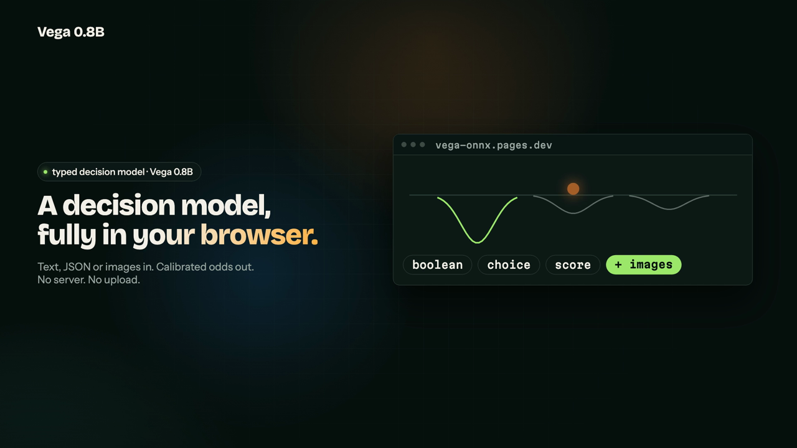
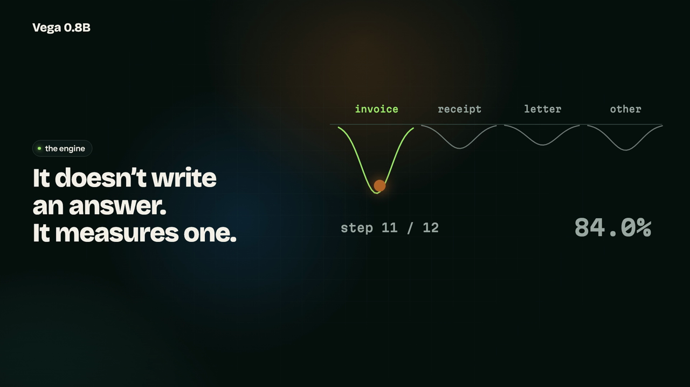
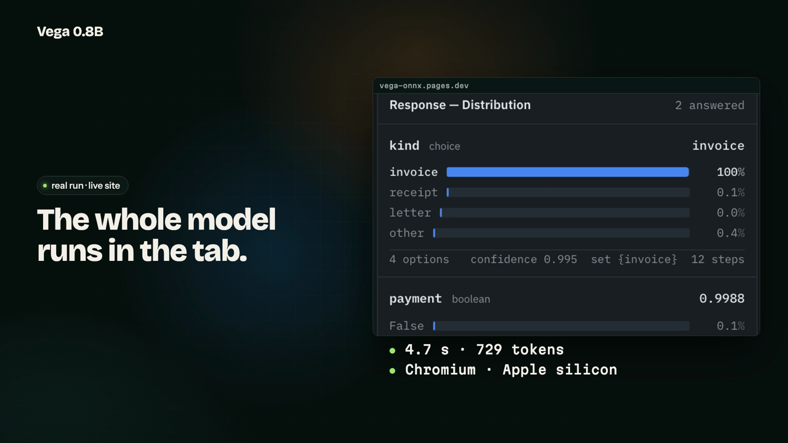
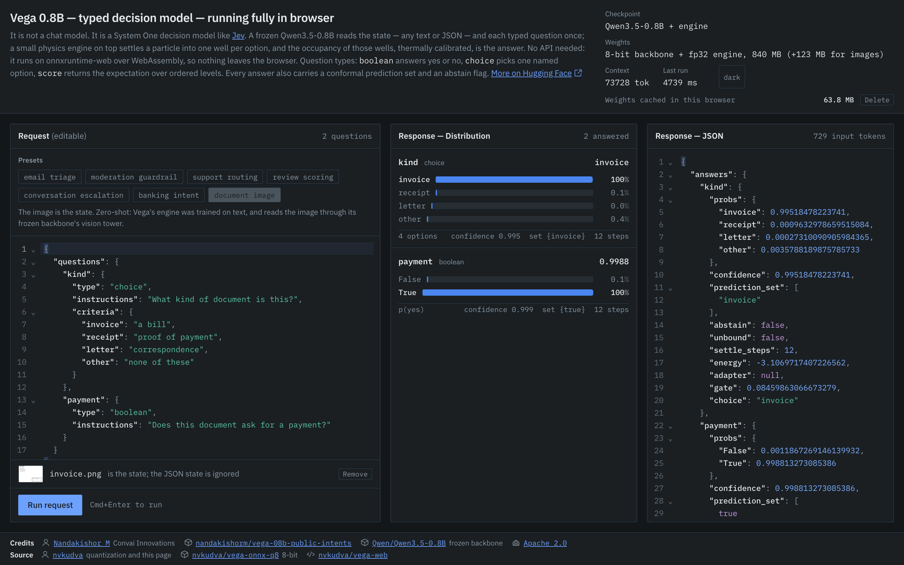

# vega-web

[Vega 0.8B](https://huggingface.co/nandakishorm/vega-08b-public-intents), a typed decision
model, running fully in the browser on onnxruntime-web (WebAssembly). Give it a state (any
text or JSON) and typed questions (`choice`, `score`, `boolean`). It returns calibrated
probabilities, a conformal prediction set, and abstain / unbound flags for each question. The
state can also be an image, read through the backbone's vision tower (zero-shot). Nothing leaves
the browser.

**Site: [vega-onnx.pages.dev](https://vega-onnx.pages.dev)** · weights on
[Hugging Face](https://huggingface.co/nvkudva/vega-onnx-q8) · model card in [`hf/README.md`](hf/README.md)

<video src="marketing/vega-launch-16x9.mp4" controls muted width="100%"></video>

<p align="center">
  
  
  
</p>

## What it does

- **Fully in the browser.** The decision model, its weights and the inference all run in your tab. No server, no API key, no upload.
- **Typed questions.** Any text or JSON state, plus `boolean`, `choice` and `score` questions. Each answer is a calibrated distribution with a conformal set and an abstain flag.
- **Images too.** An image can be the state, read zero-shot through the vision tower. A 640×480 invoice, two questions, 729 tokens: 4.7 s (Chromium, Apple silicon).



## How it fits in a browser

Vega is a frozen Qwen3.5-0.8B plus a 14M-parameter physics engine that reads hidden states at
layers 13 and 19. The browser ships:

| file | what | size |
|---|---|---|
| `embed_q8.onnx(.data)` | onnx-community's 8-bit Qwen3.5-0.8B token embeddings | 294 MB |
| `decoder_q8.onnx(.data)` | its 8-bit decoder cut after layer 19: `inputs_embeds` + M-RoPE positions in, `h13`, `h19` out | 483 MB |
| `engine.onnx` | engine + both gated adapters, fp32 | 63 MB |
| `vision_q8.onnx(.data)` | 8-bit vision encoder, fetched only the first time an image is used | 123 MB |
| `vega_web.json`, `preprocessor_config.json` | prompt/pooling/vision settings, every calibration block, image processor | 3 KB |
| `tokenizer.json`, `tokenizer_config.json` | Qwen3.5 tokenizer | 13 MB |

An image replaces the state, as in the model repo's `vega_vision.py`: its single image pad token is
expanded to one token per merged 32×32 patch, the vision encoder's features are spliced over those
embeddings, and the decoder gets Qwen3.5's 3-row M-RoPE positions. The engine, adapters and
calibration are unchanged; the engine was trained on text, so the image path is zero-shot.

Pooling, thermal calibration and the answer assembly are TypeScript (`app/src/vega`).
See [PLAN.md](PLAN.md) for the decisions.

Parity against the PyTorch model over 30 questions: the 8-bit backbone keeps every argmax
(mean KL 4.0e-04); 4-bit flips 3 of 30 (mean KL 0.07) and is not used. In the browser the TS
port reproduces the 8-bit numbers exactly. One question takes ~0.5–0.8 s under 100 tokens,
~10 s at 1.1k and ~120 s at 6k (Chromium, Apple silicon, 8 threads): every question re-reads
the state, so long records are slow.

Images: on three synthetic documents the browser matches `vega_vision.py` on every answer (mean
KL 7.7e-4); an image question takes ~4–10 s depending on size (up to 1024 image tokens).

## Rebuild the weights

```sh
cd export
uv venv .venv --python 3.12
uv pip install --python .venv/bin/python "transformers>=5.2" torch safetensors numpy onnx onnxruntime huggingface_hub
H=.venv/bin/hf
$H download nandakishorm/vega-08b-public-intents engine.safetensors adapters/public_intents.safetensors adapters/typed_decisions.safetensors --local-dir vega
$H download Qwen/Qwen3.5-0.8B --local-dir qwen
$H download onnx-community/Qwen3.5-0.8B-Text-ONNX --local-dir onnxc --include "onnx/model.onnx*" "onnx/model_quantized.onnx*"
python3 make_fixtures.py
.venv/bin/python dump_golden.py              # golden/golden.json + golden.npz (CPU, slow)
.venv/bin/python export_engine.py            # out/engine.onnx + out/vega_web.json
$H download onnx-community/Qwen3.5-0.8B-ONNX --local-dir onnxmm --include "onnx/embed_tokens*" "onnx/vision_encoder*" "onnx/decoder_model_merged*"
.venv/bin/python make_images.py && .venv/bin/python dump_golden_vision.py   # image golden
.venv/bin/python cut_backbone.py decoder_model_merged_quantized decoder_q8 onnxmm/onnx
.venv/bin/python package_mm.py               # out/embed_q8, out/vision_q8, vision settings
.venv/bin/python verify_mm.py q8             # parity gate: text + image vs golden
python3 make_parity.py                       # app/public/parity.json
```

`vega/vega_api.py`, `vega/vega_common.py` and the configs come from the model repo (Apache 2.0).

## Run the app

```sh
cd app
bun install
bun run dev -- --port 5174
```

With `VITE_MODELS_BASE` unset, the app serves weights from `app/public/models/v1` (symlink
`export/out/*` and the Qwen tokenizer files there). `/parity.html` runs the TS port against
golden: token ids and spans, then end-to-end `decide()`, then the image path against `vega_vision.py`
(`?vision` skips the slow text gate).

## Deploying

Weights go to the Hugging Face repo `nvkudva/vega-onnx-q8` under `v2/` (the decoder data is
483 MB, far over Cloudflare Pages' 25 MiB per-file cap). The version segment is part of the
browser cache key: a re-export goes to a new one. `v1/` holds the earlier text-only backbone. `app/.env.production` points the build there.

```sh
H=export/.venv/bin/hf
for f in export/out/{embed,decoder,vision}_q8.onnx{,.data} export/out/engine.onnx export/out/vega_web.json \
         export/out/preprocessor_config.json export/qwen/tokenizer.json export/qwen/tokenizer_config.json; do
  $H upload nvkudva/vega-onnx-q8 $f v2/$(basename $f)
done
$H upload nvkudva/vega-onnx-q8 hf/README.md README.md
bun run --cwd app build
bunx wrangler pages deploy app/dist --project-name vega-onnx
```

The site is the Cloudflare Pages project `vega-onnx`; `vega-web.pages.dev` belongs to an
unrelated site. `app/public/_headers` sends `Cross-Origin-Opener-Policy: same-origin` and
`Cross-Origin-Embedder-Policy: require-corp`, which wasm threads need. wrangler 4.144+ routes
`pages project create` to Cloudflare Workers; a new Pages project needs `--force` once, at
creation.

## Layout

```
app/           vite + react + ts playground; app/src/vega is the TS port of the model API
export/        python: golden reference, engine export, backbone cut, parity verifier
export/vega/   vega_api.py, vega_common.py and configs from the model repo (weights not tracked)
golden/        fixtures + the PyTorch reference dump everything is measured against
hf/            the model card published with the weights
PLAN.md        architecture, decisions, measured results, rejected alternatives
TODO.md        task state
```
